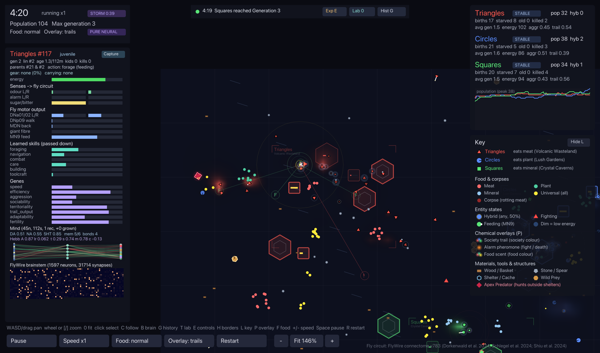

# Evolving Societies

A native, real-time artificial-life sandbox where three societies — **Triangles**, **Circles**, and **Squares** — live, learn, build, hunt, and evolve across generations in a living 2D world.

Built in Zig with raylib as a fast, standalone desktop app with zero external runtime dependencies.



## What It's About

Instead of scripting fixed rules for every behavior, *Evolving Societies* gives creatures senses, chemical fields, physical needs, and plastic neural networks — then lets survival, learning, and natural selection shape what happens next.

You can sit back and watch lineages adapt over hours, click any individual to inspect its brain and memories live, or step in as an experimenter to trigger storms, famine, predators, or genetic mutations.

## Key Features

- **Pure Neural Mode & Live Online Learning:** Every individual runs a growing, recurrent neural network with continuous motor outputs (`turn`, `speed`, `neuromodulator`, `vocal call`). Through exploratory motor babbling and dopamine-modulated Hebbian plasticity, individuals adapt *during* their lifetime while evolution grows new neurons, synapses, and recurrent memory loops across generations. Runs in **Pure Neural** mode by default (zero steering autopilot), with a live **Assisted** toggle in Experiment Controls (`E`) to compare both side by side.
- **Episodic Mental Maps & Social Bonds:** Creatures remember up to 6 spatial landmarks (food patches, quarries, shelters, prey, danger zones), clear stale beliefs when a remembered spot runs empty, share memories with kin on contact, and form social trust bonds.
- **Emergent Tools & Stigmergic Building:** Renewable **Wood** and **Stone** deposits let societies organically discover **Baskets** (foraging boost), **Spears** (hunting & defense), **Shelters** (storm refuge and physical walls against predators), and **Food Caches** (communal stores — and raid targets for rival societies).
- **Living Ecosystem, Wildlife & Weather:** Dynamic 5-minute **Calm → Bloom → Storm** weather cycles, diffusing food scents, society trails, and alarm pheromones, roaming **Wild Prey**, hunting **Apex Predators**, cross-society cache raiding, and emergent starvation cannibalism under extreme famine.
- **Developmental Life Stages & Culture:** Realistic 1–2 hour simulated lifespans progress through **Infant → Juvenile → Adult → Elder** with childhood learning windows, elder mentoring, communal childcare, inherited skills, and emergent colony roles (`forager`, `scout`, `guard`, `caretaker`, `builder`, `hunter`, `elder`).
- **Specimen Lab (`T`) & Experiment Controls (`E`):** Capture any creature to compare generations side-by-side, tweak traits/skills, mutate brains, and release clone batches (`x1`–`x50`). Use Experiment Controls to flood or clear food, jump weather phases, spawn prey or apex predators, or toggle Pure Neural vs. Assisted mode live.
- **Uncapped Populations & Automatic Telemetry:** An $O(N)$ spatial hash grid keeps large civilizations running smoothly, while every run automatically logs CSV telemetry that can be summarized with `tools/analyze_run.py`.

## Download & Run (macOS)

Grab the latest **`Evolving-Societies-macOS.dmg`** from the [Releases](https://github.com/nevil-ing/evolving-societies/releases) page:

1. Open `Evolving-Societies-macOS.dmg` and drag **Evolving Societies** into **Applications**.
2. Launch it from **Applications**, **Spotlight**, or **Launchpad**.
   *(Because the app is ad-hoc signed without an Apple Developer certificate, on first launch macOS may ask you to right-click the app → **Open**, or allow it once under **System Settings → Privacy & Security**.)*

When launched as a macOS app, run telemetry CSVs are saved automatically to `~/Library/Application Support/Evolving Societies/runs/`.

## Building from Source

Requires [Zig 0.17.0](https://ziglang.org/download/). `raylib 6.2` is fetched automatically by the build system.

```bash
cd sim
zig build run -Doptimize=ReleaseFast
```

### Build the Native macOS `.app` & `.dmg`

```bash
./tools/package_macos_app.sh --install --dmg
```

This compiles a `ReleaseFast` binary, generates the Retina `AppIcon.icns`, assembles `dist/Evolving Societies.app`, installs it into `/Applications/Evolving Societies.app`, and creates `dist/Evolving-Societies-macOS.dmg`.

### Headless Runs, Screenshots & Tests

```bash
# Headless 10-minute simulation with CSV telemetry analysis
./sim/zig-out/bin/evolving-societies --headless 600 --seed 8080 --out run.csv
python3 tools/analyze_run.py run.csv

# Capture a Retina screenshot after simulating 260s
./sim/zig-out/bin/evolving-societies --seed 8080 --shot docs/screenshot.png 260 0.65

# Run the test suite
cd sim
zig build test -Doptimize=ReleaseFast              # fast unit & online-learning checks
zig build test -Doptimize=ReleaseFast -Dslow=true  # plus chemotaxis & 6-seed 10-minute worlds
```

<details>
<summary>macOS troubleshooting: build fails fetching <code>xcode_frameworks</code></summary>

If Zig's HTTP client fails the TLS handshake with `pkg.machengine.org`, download the package with `curl` into the Zig global cache:

```bash
H=N-V-__8AALShqgXkvqYU6f__FrA22SMWmi2TXCJjNTO1m8XJ
curl -L -o xf.tar.gz https://pkg.machengine.org/xcode-frameworks/8a1cfb373587ea4c9bb1468b7c986462d8d4e10e.tar.gz
mkdir -p $H && tar xzf xf.tar.gz -C $H --strip-components=1
CACHE=$(zig env | sed -n 's/.*\.global_cache_dir = "\(.*\)",/\1/p')
COPYFILE_DISABLE=1 tar --no-xattrs --no-mac-metadata -czf "$CACHE/p/$H.tar.gz" $H
```

</details>

## Controls

| Input | Action |
| --- | --- |
| `WASD` / arrows, right-drag | Pan camera |
| Mouse wheel / `[` `]` / `0` | Zoom / fit whole world |
| Left-click | Select & inspect an individual (genes, skills, live mind graph, mental map) |
| `C` | Follow selected individual |
| `B` | Toggle live brain visualization in Inspector |
| `E` | Open **Experiment Controls** (Pure Neural toggle, spawning, food flood/wipe, weather, wildlife) |
| `T` | Open **Specimen Lab** (capture, compare, edit traits/skills, mutate, clone) |
| `G` | Open **History & Generations** panel |
| `H` | Toggle territory corner brackets |
| `L` | Toggle world legend / key |
| `P` | Cycle chemical overlays (trails & alarm / food scent / off) |
| `F` | Cycle food scarcity (`feast` / `abundant` / `normal` / `scarce` / `famine`) |
| `+` / `-` | Simulation speed (`1×` up to `64×`) |
| `Space` | Pause / resume |
| `R` | Start a new world |

## Project Layout

```text
sim/
  src/world.zig        societies, ecology, physics, wildlife, structures, tools, memory & learning
  src/genome.zig       traits, growing recurrent CognitiveBrain, node-perturbation & ABCD plasticity
  src/pheromone.zig    diffusing chemical fields (scent, trails, alarm)
  src/flybrain.zig     embedded sensorimotor brainstem circuit rate model
  src/logger.zig       automatic CSV telemetry exporter
  src/life_view.zig    2D renderer, HUD, Inspector, Specimen Lab, Experiment Controls & History
  src/ui.zig           Retina HiDPI helpers, font loading, camera & screenshot capture
  src/main.zig         CLI entry point (interactive, --headless, --shot)
  src/tests.zig        unit, online-learning, chemotaxis & multi-seed survival tests
  assets/flybrain.bin  pre-built binary sensorimotor circuit
tools/
  package_macos_app.sh builds native macOS .app bundle, /Applications install & .dmg
  make_icon.py         generates Retina AppIcon.icns
  analyze_run.py       summarizes CSV run telemetry (trait drift, skills, brain growth, roles)
  extract_circuit.py   rebuilds sim/assets/flybrain.bin from source connectivity tables
```

## Credits & License

The bundled low-level sensorimotor brainstem data (`sim/assets/flybrain.bin`) is derived from [FlyWire](https://flywire.ai) connectome release v783 (Dorkenwald et al. 2024; Schlegel et al. 2024; Shiu et al. 2024) and is distributed under [CC BY-NC 4.0](https://creativecommons.org/licenses/by-nc/4.0/) — see [`sim/assets/DATA_LICENSE.md`](sim/assets/DATA_LICENSE.md) for full citations.
